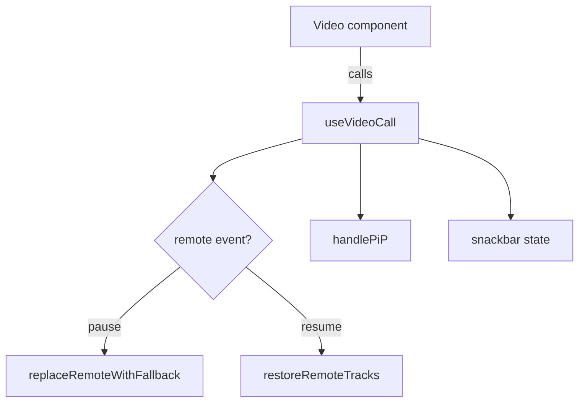

# Picture-in-Picture (PiP) Implementation Guide

This guide explains how the video call prototype enables Picture-in-Picture (PiP) mode, how PiP can be toggled at runtime, and what happens when pause/resume events arrive from the signalling server.

## Hook Overview

PiP support lives inside `useVideoCall` (`src/components/hooks/useVideoCall.js`). The hook encapsulates the deeply stateful parts of the Video component: attaching Twilio tracks, reacting to socket events, managing fallback UI, and exposing the PiP control.



## Toggling PiP

`useVideoCall` exposes a `handlePiP` callback that encapsulates the specific browser API calls needed to enter and exit Picture-in-Picture.

```javascript
// src/components/hooks/useVideoCall.js
const handlePiP = useCallback(async () => {
  if (!document.pictureInPictureEnabled) {
    alert('Picture-in-Picture is not supported on this browser.');
    return;
  }

  const videoEl = remoteVideoRef.current?.querySelector('video');
  if (!videoEl) {
    console.log('No remote video element available for PiP');
    return;
  }

  try {
    if (document.pictureInPictureElement) {
      await document.exitPictureInPicture();
    } else {
      await videoEl.requestPictureInPicture();
    }
  } catch (err) {
    console.error('Failed to toggle PiP', err);
  }
}, []);
```

Key details:

- **Capability guard:** The function bails out early with an alert if the browser lacks PiP support, preventing silent failures.
- **Reliable target element:** It resolves the active remote `<video>` element from `remoteVideoRef`. This is the same element Twilio populates with the subscribed track, so the PiP window always reflects the correct stream (or fallback video during pauses).
- **Toggle semantics:** The callback decides between `requestPictureInPicture()` and `exitPictureInPicture()` based on whether another element is already in PiP (`document.pictureInPictureElement`). This keeps the UI toggle idempotent.
- **Error handling:** Any DOM or permission errors from the browser are caught and logged, avoiding unhandled promise rejections that could break the React event loop.

In the UI layer you simply import the hook and connect the handler to a control:

```javascript
import { useVideoCall } from '../hooks/useVideoCall';

const Video = ({ roomId, userId }) => {
  const { remoteVideoRef, localVideoRef, handlePiP } = useVideoCall(roomId, userId);

  return (
    <>
      <div ref={remoteVideoRef} />
      <div ref={localVideoRef} />
      <button onClick={handlePiP}>Toggle PiP</button>
    </>
  );
};
```

Because the hook owns the browser checks, remote element lookup, and error recovery, the calling component stays declarative—just wire the returned handler to any trigger (button, keyboard shortcut, context menu item, etc.) and PiP will follow suit.

## Responding to Remote Events

The socket listener registered inside `useVideoCall` subscribes to the `NEXT_PUBLIC_VIDEO_EVENT` channel (default `video-event`). Incoming payloads are normalised and drive the following behaviour:

- **Pause events** call `replaceRemoteWithFallback()`. This swaps the remote container to a local `/vid.mp4` loop, maintains autoplay friendliness with interaction listeners, and keeps the layout intact while the real remote stream is unavailable.
- **Resume events** call `restoreRemoteTracks()`. The helper clears the override flag, resets the existing `<video>` element, and re-attaches every subscribed remote track. Local tracks stay bound to the self-view, ensuring the local preview never disappears after a resume.
- Any event message also updates the snackbar state so users get immediate feedback about the room change that triggered the PiP or fallback logic.

### Keeping PiP in Sync with Event Changes

Both pause and resume flows intentionally operate on the **same `<video>` element** that PiP uses. Because browsers keep the Picture-in-Picture window tied to the underlying DOM node, swapping the media source while keeping the node alive lets us update PiP content without tearing down the window.

#### Pause → Fallback

```javascript
const replaceRemoteWithFallback = useCallback(() => {
  const container = remoteVideoRef.current;
  // ...create or reuse the <video> node...

  const wasInPiP = document.pictureInPictureElement === fallbackVideo;

  fallbackVideo.pause?.();
  fallbackVideo.removeAttribute('src');
  fallbackVideo.srcObject = null;
  fallbackVideo.src = '/vid.mp4';
  fallbackVideo.load();

  // Clean up any remote track attachments so the fallback is the only source
  room.participants.forEach(participant => {
    participant.tracks.forEach(publication => {
      const track = publication.track;
      if (track?.kind === 'video') {
        track.detach().forEach(el => {
          if (el !== fallbackVideo) el.remove();
        });
      }
    });
  });

  if (wasInPiP) {
    fallbackVideo.requestPictureInPicture?.().catch(/* … */);
  }
}, [remoteVideoRef, roomRef]);
```

- The hook preserves the previously attached `<video>` element when inserting the fallback stream, so an active PiP window keeps pointing at the same node.
- If PiP was active, we explicitly call `requestPictureInPicture()` on the fallback video. This ensures the browser updates the PiP window to show the fallback clip even if the track swap happened while PiP was detached (some browsers briefly exit PiP when sources change).

#### Resume → Remote Stream

```javascript
const restoreRemoteTracks = useCallback(() => {
  const room = roomRef.current;
  // ...clear the override and reset the existing <video> element...

  room.participants.forEach(participant => {
    participant.tracks.forEach(pub => {
      if (pub.track) {
        attachRemoteRef.current(pub.track, true);
      }
    });
  });
}, [remoteVideoRef]);
```

- We reuse the exact same `<video>` element that the fallback occupied. Once Twilio re-attaches the remote track to that node, the PiP window automatically shows the live stream again because the DOM node never changed.
- Passing `true` to `attachRemoteRef.current` forces a reattachment even if the container was previously marked as an override, guaranteeing that resume events immediately overwrite the fallback source.

## Integrating PiP Elsewhere

When creating another component that needs PiP capability:

1. Call `const { remoteVideoRef, handlePiP } = useVideoCall(roomId, userId);` in the component body.
2. Attach `remoteVideoRef` (and `localVideoRef` if needed) to empty containers in the JSX to let Twilio populate them.
3. Hook up `handlePiP` to any UI element (button, menu item, etc.) that should toggle PiP.
4. Optionally consume `snackbarState` and `dismissSnackbar` to surface event notifications.

Because the hook owns the socket lifecycle and event routing, no additional wiring is required—the component automatically reacts to pause/resume and keeps PiP consistent.

## Testing Checklist

- **Browser capability:** Verify the alert renders when PiP is not supported (e.g., browsers without `document.pictureInPictureEnabled`).
- **Pause flow:** Trigger a pause event and confirm the fallback video appears both in the main layout and, if PiP was active, inside the PiP window.
- **Resume flow:** After a pause, send a resume directive and ensure the remote stream reattaches without disturbing the local self-view.
- **Toggle loop:** Rapidly toggle PiP before and after events to confirm the hook handles asynchronous state transitions gracefully.

Following these steps keeps the PiP experience resilient while still giving the UI full control over how and when PiP is exposed to users.
